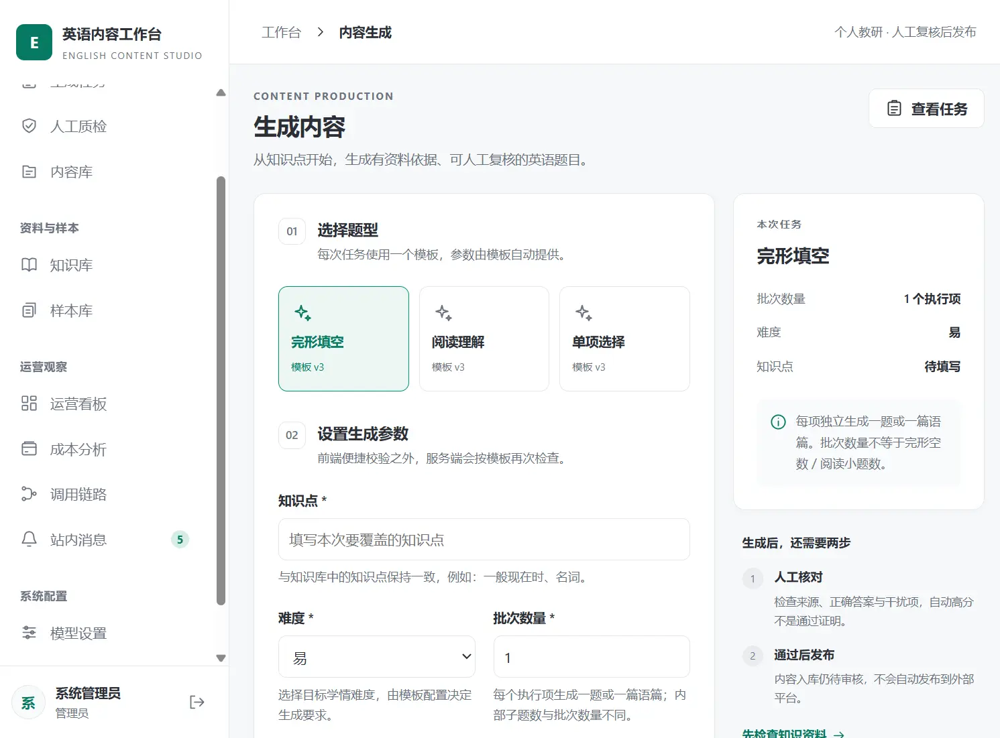
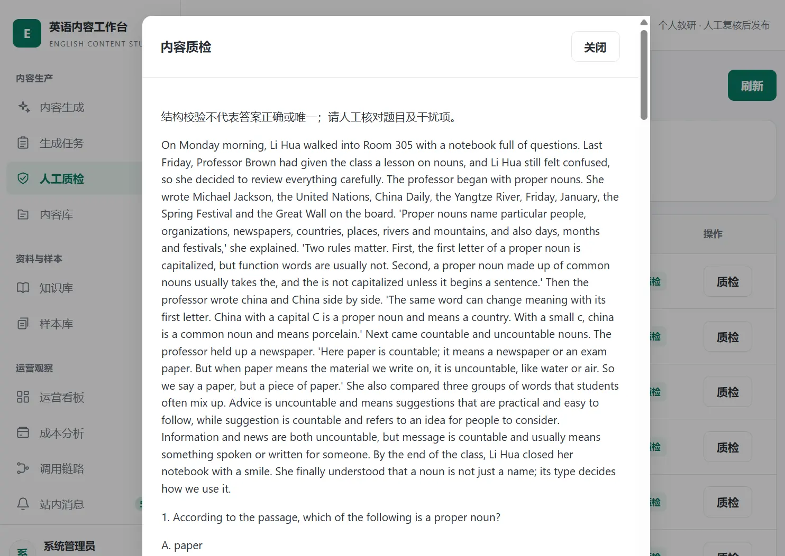
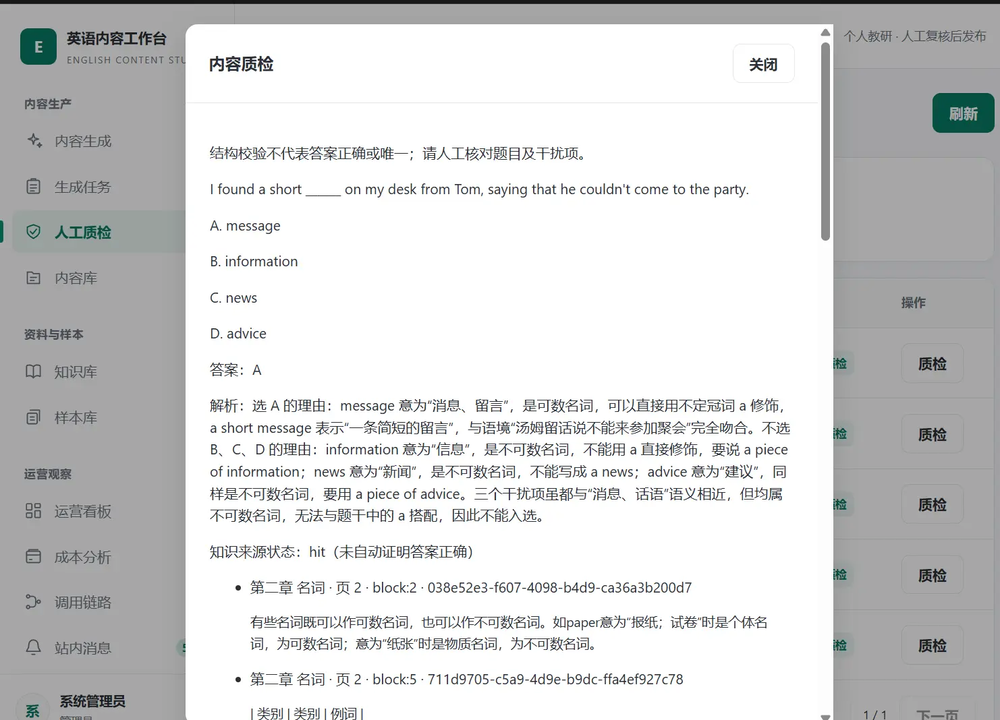
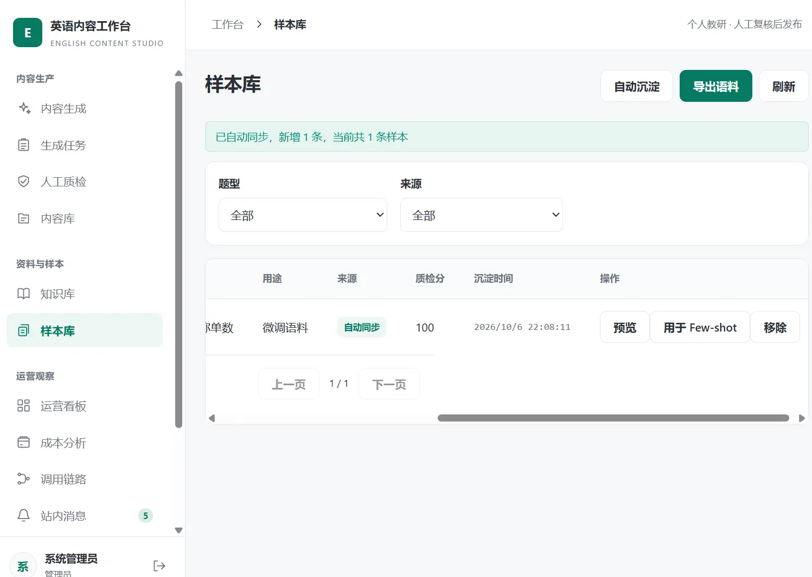
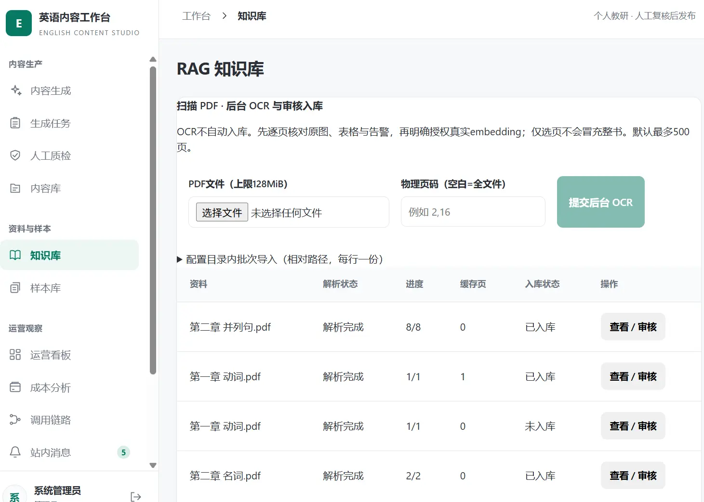
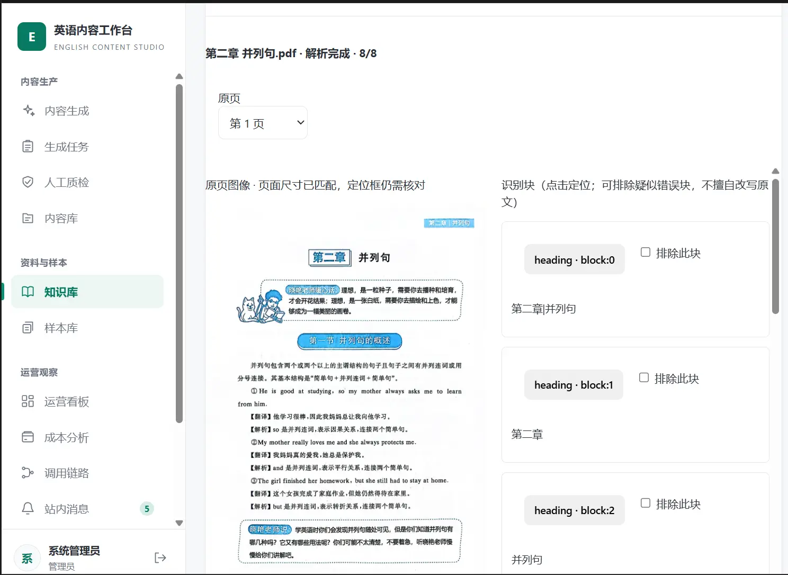
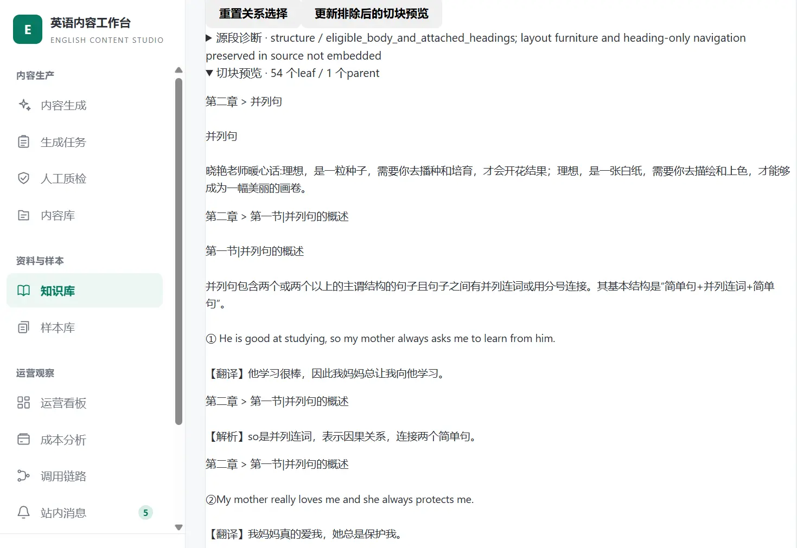
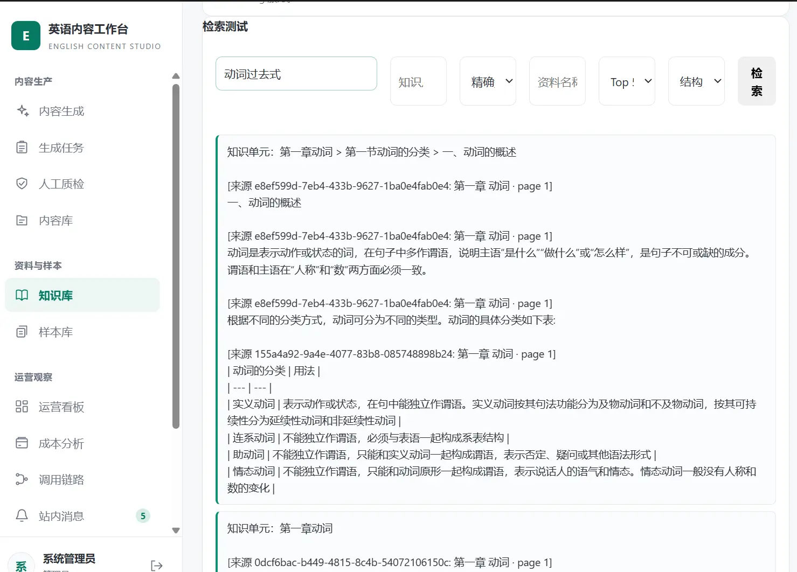
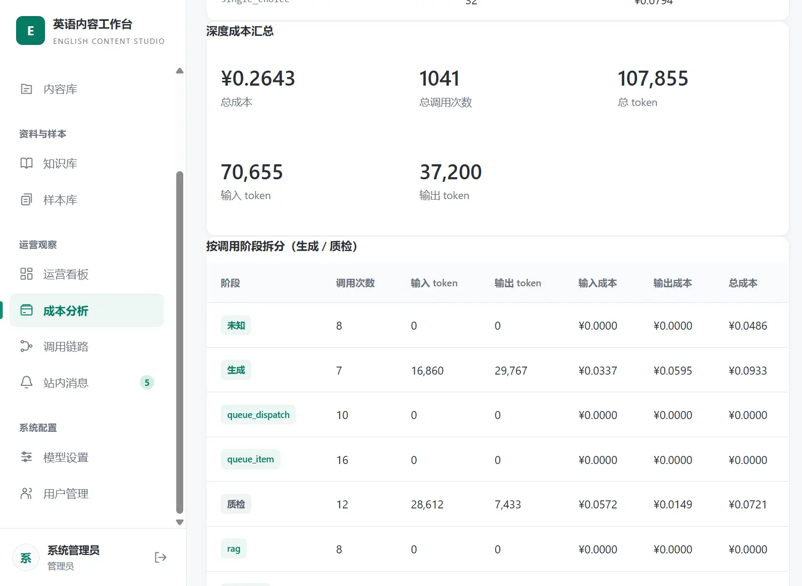
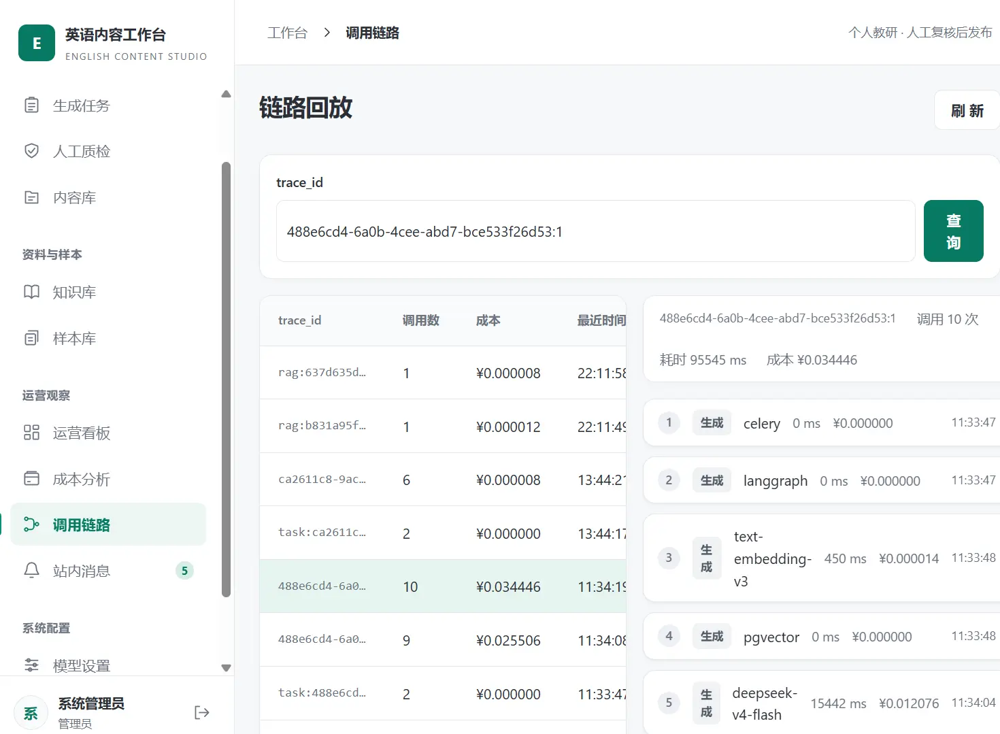

# 英语内容生产工作台｜项目演示

这是一个面向英语教研场景的 AI 内容生产工作台，覆盖 **内容生成、质量检测、样本沉淀、知识库构建、检索测试、成本统计与调用链路追踪** 等环节。

系统的核心目标不是简单调用大模型，而是将大模型能力接入一条可追踪、可复核、可持续优化的内容生产流程：

> **资料接入 → 知识检索 → 内容生成 → 自动质检 → 人工复核 → 样本沉淀 → 成本与链路分析**

以下截图展示当前工作台的主要功能。

> 截图取自本机运行环境，为演示数据；界面细节可能随版本迭代变化。
>
> 返回 [README](../../README.md) ｜ 维护者文档见 [当前实现与系统架构](英语内容生产工作台-当前实现与系统架构.md)

---

## 1. 内容生成

根据知识点、题型、难度和数量等参数，批量生成英语教学内容。目前支持单项选择、完形填空、阅读理解等题型。

生成内容会经过结构化校验和自动质量检测，并保留本次生成所使用的参数及来源信息，便于后续复核和追踪。

## 2. 人工内容质量检测

自动质检完成后，内容进入人工复核环节。复核人员可以查看题目、选项、答案、解析以及对应的知识来源，并根据实际教学要求决定通过、修改或驳回。

自动评分用于辅助筛选，不能替代人工对答案正确性、选项质量、解析准确性和来源一致性的最终判断。

### 阅读理解质检

### 单项选择质检

## 3. 高质量样本库

将人工复核通过的优质题目沉淀到样本库中，用于后续示例参考、质量分析和数据回流，为持续优化生成效果提供基础。

## 4. RAG 知识库

支持上传 PDF、Word 等教研资料，经过解析、结构化切分和向量化后建立知识索引，用于生成前的知识检索与上下文注入。

系统保留原始资料、结构化来源片段和索引元数据，便于定位每条知识内容的来源位置。对于结构化切分结果，可以在正式入库前进行预览和人工审核。

### PDF 解析与切分结果

展示 PDF 解析后的文档结构、章节关系、页面信息和知识片段。跨页内容可以按照结构关系组织，而不是简单地按物理页强制截断。

### 编辑后的切块预览

在正式索引前，可以检查切分边界、来源映射和结构化上下文，必要时调整审核结果后再执行向量化入库。

## 5. 检索测试

通过输入自然语言问题，查看系统实际召回的知识片段、来源页码、结构关系和上下文组合结果，用于验证知识库的召回效果和来源可追溯性。

检索测试关注的不只是“是否命中某一页”，还会检查实际返回的来源片段是否完整，以及跨页、跨段落和跨结构关系是否能够正确恢复。

## 6. 成本统计

统计模型调用次数、Token 使用量、调用阶段、耗时和成本估算，帮助了解不同题型、任务和模型配置的资源消耗，为后续批量生产和模型路由优化提供依据。

成本统计中的金额属于系统配置口径下的估算值，实际供应商账单仍以服务商后台为准。

## 7. 调用链路回放

每次生成、质检和相关模型调用都绑定唯一链路标识，记录输入、输出、模型、耗时、Token、成本和失败重试信息。

通过链路回放，可以定位一条内容从知识检索、模型生成、结构化校验到自动质检的完整过程，便于问题排查、质量复盘和成本分析。

## 8. 当前定位

当前系统适合用于：

- 个人英语教研资料管理；
- 小批量题目生成与人工复核；
- RAG 知识库检索效果验证；
- 生成质量、调用成本和失败链路分析；
- 高质量题目样本沉淀与持续优化。

系统目前仍坚持 **“自动生成 + 自动检测 + 人工复核”** 的工作模式。自动质检分数和知识召回结果不能直接等同于内容事实正确，正式发布前仍需要人工核验。

---

## 相关文档

- [README](../../README.md)：项目概览、技术栈、快速开始与配置项
- [当前实现与系统架构](英语内容生产工作台-当前实现与系统架构.md)：架构、两条业务链路、数据模型、任务可靠性与验证边界
- [工程约束](../../AGENTS.md) ｜ [贡献说明](../../CONTRIBUTING.md)
